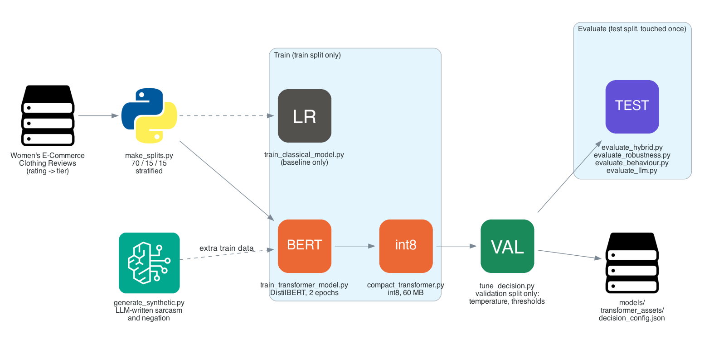
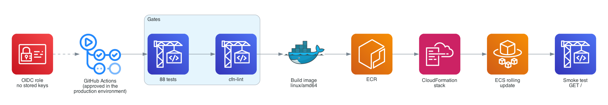

# Hybrid Customer-Dissatisfaction Risk Triage on AWS: Classical ML, Fine-Tuned DistilBERT on PyTorch, a Calibrated Decision Layer, Deterministic Review Rules and LLM Explanations from Amazon Bedrock (Nova Lite), Served with FastAPI, Docker, CloudFormation, ECS Fargate, CloudFront, AWS WAF, Secrets Manager and CloudWatch

Built with: **Python** 3.11; **scikit-learn** with **TF-IDF** and **Logistic Regression**; **PyTorch** and **Hugging Face Transformers** with a fine-tuned **DistilBERT** stored as **int8** weights; a pure **NumPy** decision layer with **temperature calibration**, probability blending, tuned thresholds and review triggers; **Amazon Bedrock** with **Nova Lite** for explanations; **FastAPI** and **Pydantic**; **Docker**; **AWS CloudFormation**, **Amazon ECS** on **AWS Fargate**, an **Application Load Balancer**, **Amazon CloudFront**, **AWS WAF**, **AWS Secrets Manager**, **Amazon CloudWatch** with **EMF** metrics and alarms, and **GitHub Actions** with **OIDC**; **pytest**.

[](https://github.com/anandapurva55/hybrid-complaint-risk-ai/actions/workflows/ci.yml)


A system that reads a piece of customer feedback and answers three practical questions: **how unhappy is this customer** (low, medium or high), **what should happen next** (reply automatically, send to a person, or escalate), and **why**. Two text models estimate the tier, a small deterministic layer turns their probabilities into a decision, and a language model writes a plain-English explanation. The language model can describe the decision, never change it.

| **0.71** | **0.67** | **98.6%** | **70.7%** | **29%** | **68** |
|:---:|:---:|:---:|:---:|:---:|:---:|
| Recall on the "high" tier | **Macro-F1** (95% CI 0.65 to 0.69) | Truly-high cases that reach a person (350 of 355) | Feedback answered automatically (97.5% of them truly low) | Feedback sent to human review | Automated tests |


---

## Table of contents

1. [About the data and the label](#about-the-data-and-the-label)
2. [Quickstart](#quickstart)
3. [How it works](#how-it-works)
4. [Results](#results)
5. [Explainability](#explainability)
6. [Safety and guardrails](#safety-and-guardrails)
7. [Training pipeline](#training-pipeline)
8. [AWS architecture](#aws-architecture)
9. [API](#api)
10. [Configuration](#configuration)
11. [File by file](#file-by-file)
12. [Testing](#testing)
13. [Design decisions](#design-decisions)
14. [Limitations and next steps](#limitations-and-next-steps)

## About the data and the label

The model is trained on the public [Women's E-Commerce Clothing Reviews](Womens%20Clothing%20E-Commerce%20Reviews.csv) dataset (about 22,600 reviews with text, age, department and a 1 to 5 star rating). Public data with real complaint-escalation outcomes does not exist, so the project uses the star rating as a stand-in for how dissatisfied the customer is:

| Stars | Tier used by the system | Meaning |
|---|---|---|
| 1 to 2 | `high` | Strongly unhappy, the cases a support team most wants to catch |
| 3 | `medium` | Mixed or neutral |
| 4 to 5 | `low` | Happy, safe to acknowledge automatically |

So every number in this README measures how well the system recognises **dissatisfaction** from the text. That is a useful, measurable signal for triage, and it is the part of "will this customer escalate?" that feedback text actually carries. The code is built so the label is one swappable function ([`rating_to_risk`](risk_common.py)): when you have real outcomes such as reopened tickets, refunds or chargebacks, point `make_splits.py` at them, rerun the pipeline and the calibration and **thresholds** are re-tuned for you. Names like `risk_level` are kept for continuity.

**Intended use.** Prioritising and routing English-language product feedback for human reviewers, and auto-acknowledging clearly positive messages. **Out of scope:** fully automated customer-facing decisions on negative feedback, other languages or industries without re-validation, and any use as a statistical estimate of churn or regulatory escalation.

## Quickstart

```bash
python3.11 -m venv venv && source venv/bin/activate
pip install -r requirements-dev.txt

python hybrid_inference.py        # run the 8 bundled examples (explanations need AWS credentials with Bedrock access)
python -m pytest                  # 68 tests
uvicorn app:app --reload          # HTTP API on http://127.0.0.1:8000
```

```bash
curl -X POST http://127.0.0.1:8000/predict -H "Content-Type: application/json" \
  -d '{"review_text":"The jacket fell apart after one wear and nobody answers my emails.",
       "age":45,"positive_feedback_count":1,"division_name":"General",
       "department_name":"Jackets","class_name":"Outerwear"}'
```

No AWS credentials or **Bedrock** access? Everything still works: the explanation comes from a local fallback and is labelled `"explanation_source": "fallback"`. Set `LLM_PROVIDER=none` to skip the call entirely.

## How it works


Each piece of feedback goes through two models that each output three probabilities for low, medium and high. The first is a **classical model** that feeds **TF-IDF** word features plus age and product category into **Logistic Regression**. The second is a **DistilBERT transformer**, **fine-tuned** on the reviews, which understands phrasing and context much better and does most of the work. Their probabilities go through **temperature calibration** so that "80%" really means about 80%, are blended (10% classical, 90% **transformer**, the weight that gave the lowest validation **log-loss**), and are turned into a tier with two **thresholds** tuned on validation data to reach at least 70% **recall** on the truly unhappy customers. A few deterministic **review triggers** then decide whether a person must look. Only after all of that does an **LLM** on **Amazon Bedrock** write the explanation.

**What happens on one request.**


**How the decision and the review rules work.**


The **thresholds**, temperatures, blend weight and trigger limits live in [`decision_config.json`](decision_config.json) and are produced by [`tune_decision.py`](tune_decision.py) from the validation split only. The four **review triggers** are: the two models disagree (total-variation distance above 0.45), the top probability is below 0.45, low and high are both at least 0.30 likely, or the text is shorter than four words.

### The calibrated decision layer, step by step

All of this lives in [`decision.py`](decision.py), uses only **NumPy** and has no model code in it. Its numbers come from [`decision_config.json`](decision_config.json), which [`tune_decision.py`](tune_decision.py) writes using the validation split only.

1. **Probabilities.** Each model outputs `[P(low), P(medium), P(high)]`: the **classical model** through `predict_proba`, **DistilBERT** through a softmax. The column order is fixed in one place (`reorder_proba`), because **scikit-learn** lists classes alphabetically.
2. **Temperature calibration.** Raw model confidence is often too high or too low. For each model one number `T` rescales its probabilities as `p^(1/T)` and renormalises them. `T` is found by minimising **log-loss** on the validation split over a grid from 0.5 to 4.0. The result is `T = 0.9` for the **classical model** (slightly sharper) and `T = 1.15` for **DistilBERT** (slightly softer). Class weights are deliberately not used in training, because they distort the probabilities that this layer depends on.
3. **Blending.** `p = 0.1 * classical + 0.9 * transformer`. The weight is the one with the lowest validation **log-loss** over a grid from 0 to 1 (the **LSTM** baseline got weight 0, so it left the system).
4. **Thresholds on probabilities, not on a score.** `P(high) >= 0.375` gives `high`; otherwise `P(high) + P(medium) >= 0.225` gives `medium`; otherwise `low`. The two **thresholds** come from a grid search on validation: keep only pairs that reach at least 70% **recall** on `high`, then take the best **macro-F1** (validation **recall** 0.70, **macro-F1** 0.68). Deciding on probabilities matters because an averaged score cannot tell a confident "medium" from a 50/50 split between "low" and "high"; that split is caught by a review trigger instead.

### The deterministic review rules

"Deterministic" means the same input always gives the same answer: plain rules and numbers, no randomness and no **LLM** involved. They decide **whether a person must look** and **what happens next**:

| Rule | Condition | Effect |
|---|---|---|
| High tier | `P(high)` at or above `t_high` | `escalate_immediately`, human review |
| Medium tier | medium decision | `manual_review`, human review |
| `conflicted` | low and high are both at least 0.30 likely | review |
| `low_confidence` | the top probability is below 0.45 | review |
| `models_disagree` | the two calibrated probability vectors differ by more than 0.45 (total variation distance) | review |
| `short_text` | fewer than 4 words | review |
| Low tier, no trigger | none of the above | `auto_reply` |

A "low" case that trips any trigger is never auto-replied: `action_for` turns it into `manual_review`. After the **LLM** writes its explanation, `recommended_action` and `human_review_required` are **overwritten** from these rules, and the **LLM** can only add caution, never remove it. [`tests/test_decision.py`](tests/test_decision.py) covers every boundary and trigger.

### Policy: what the system commits to, and how to change it

- **A person stays in the loop where it matters.** A high-tier case is always escalated and reviewed, a medium-tier case always goes to manual review, and a low-tier case is answered automatically only when no review trigger fired.
- **Missing an unhappy customer costs more than a wasted review.** So the **thresholds** are tuned for **recall** on the high tier first. The price is that roughly 4 in 10 "high" flags are false alarms; move `t_high` in [`decision_config.json`](decision_config.json) to trade the other way.
- **The LLM explains and may add caution, nothing more.** It cannot change a score, the tier, the action or the review flag, and it cannot lower the flag. How this is enforced is in [Safety and guardrails](#safety-and-guardrails).
- **Changing the policy** means re-running [`tune_decision.py`](tune_decision.py) on the validation split, then [`evaluate_hybrid.py`](evaluate_hybrid.py), and checking **recall** on high, the review share and the number of truly-high cases auto-replied before accepting new values. `evaluate_hybrid.py` also refreshes the monitoring baseline.

## Results

Evaluated on the held-out test split (3,397 reviews, stratified 70/15/15 with a fixed seed), which was never used for training or tuning. The headline numbers are in the row and figure at the top. Raw numbers are written to [`evaluation_results.json`](evaluation_results.json) and [`robustness_results.json`](robustness_results.json) by [`evaluate_hybrid.py`](evaluate_hybrid.py) and [`evaluate_robustness.py`](evaluate_robustness.py). Class shares are low 77.1%, medium 12.5% and high 10.5%.

- **Model comparison:** **DistilBERT** alone reaches **macro-F1** 0.675, against 0.593 for the **classical model** and 0.547 for the **LSTM** baseline. The tuned hybrid reaches 0.673 with 0.71 **recall** on the high tier. Its edge over **DistilBERT** alone is small (+0.002 to +0.012 at 95% confidence), so the gain comes from the **transformer**.
- **Stability:** three **fine-tuning** seeds give **macro-F1** 0.666, 0.675 and 0.682, and 1,000 **bootstrap** resamples give the hybrid a 95% interval of 0.652 to 0.694.

<details>
<summary><b>Full evaluation tables</b>: components, hybrid, uncertainty, ablations, calibration, triage, subgroups, explanation layer</summary>

**Components at plain argmax (no tuning)**

| Model | Accuracy | **Macro-F1** | High **precision** | High **recall** | **AUC** (high vs rest) |
|---|---|---|---|---|---|
| Always "low" | 0.771 | 0.290 | 0 | 0 | n/a |
| **LSTM** (baseline) | 0.820 | 0.547 | 0.493 | 0.597 | 0.920 |
| Classical | 0.829 | 0.593 | 0.649 | 0.437 | 0.934 |
| **Transformer** | **0.851** | **0.675** | 0.620 | 0.639 | **0.950** |

**Hybrid (0.1 classical + 0.9 transformer, calibrated, thresholds tuned on validation)**

| System | Accuracy | **Macro-F1** | High **precision** | High **recall** | **AUC** |
|---|---|---|---|---|---|
| Transformer alone (same **thresholds**) | 0.829 | 0.667 | 0.570 | 0.710 | 0.950 |
| **Hybrid** | **0.831** | **0.673** | **0.583** | **0.710** | **0.951** |

Per-class (hybrid): low P 0.974 / R 0.900; medium P 0.395 / R 0.507 (F1 0.444); high P 0.583 / R 0.710 (F1 0.640).

| True \ predicted | low | medium | high |
|---|---|---|---|
| **low** | 2357 | 231 | 30 |
| **medium** | 59 | 215 | 150 |
| **high** | 5 | 98 | 252 |

**Uncertainty (1,000 bootstrap resamples of the test set, 95% CI):** hybrid **macro-F1** 0.652-0.694; high **recall** 0.660-0.755; high **precision** 0.540-0.629. Hybrid minus transformer-alone **macro-F1**: +0.002 to +0.012. The blend helps, but only slightly (the CI excludes zero by a hair; the comparison is mildly favourable to the hybrid because the **thresholds** were tuned for it). The **transformer** is where the gain comes from. Classical model 5-fold CV on train+val: **macro-F1** 0.586 +/- 0.011, accuracy 0.827 +/- 0.005, so test results are not a lucky split for that model.

**Training-seed variance (transformer)**
Three **fine-tuning** runs with different seeds ([`seed_runs/`](seed_runs/)): test **macro-F1** at argmax 0.675 (shipped, seed 42), 0.666 (seed 1), 0.682 (seed 2); mean 0.674, spread about +/-0.008. High-vs-rest **AUC** 0.950 / 0.951 / 0.953. The **transformer**'s advantage over the **classical model** (0.593) is many times larger than seed noise; the tiny hybrid-over-transformer gain (+0.002 to +0.012) is of the same order as seed noise, so treat it as unproven.

**History of the redesign (same test split)**

| | v1 (**CNN** fixed at 0.4, 0.45/0.75 **thresholds**) | v2 (probabilities, classical + **LSTM**) | v3 (current: classical + **DistilBERT**) |
|---|---|---|---|
| Recall on high | 0.132 | 0.730 | 0.710 |
| Precision on high | 0.681 | 0.498 | 0.583 |
| **Macro-F1** | 0.543 | 0.622 | 0.673 |
| Medium F1 | n/a | 0.353 | 0.444 |
| Truly-high cases auto-replied | 29 | 16 | 5 |
| Cases forced to human review | 80.7% | 29.7% | 29.3% |

v1 was measured by running the original models on this split. The constant **CNN** term made "high" nearly unreachable and made the disagreement rule fire on ~81% of cases.

**Leakage ablation: `Recommended IND`**
Adding it back to the **classical model** raises argmax **macro-F1** 0.593 -> 0.639 (accuracy 0.829 -> 0.863). That ~0.05 is leakage (it is a near-proxy of the rating the label comes from), which is why the feature was removed and why the first version's headline numbers (0.845 / 0.666) were inflated.

**Calibration (ECE of top-class confidence)**

| | raw | after temperature scaling (fit on validation) |
|---|---|---|
| Classical | 0.035 | 0.029 |
| Transformer | 0.025 | 0.012 |
| Hybrid | n/a | 0.013 |

**Ordinal modelling (negative result)**
Two cumulative binary models (`>=medium`, `=high`) instead of the multinomial **classical model**: best-grid **macro-F1** 0.643 vs 0.650 and high **AUC** 0.929 vs 0.934. No gain, so the multinomial form was kept.

**Triage behaviour (test set)**

| Action | Share |
|---|---|
| `auto_reply` | 70.7% |
| `manual_review` | 16.6% |
| `escalate_immediately` | 12.7% |

- Human review (high, medium, or any trigger): 29.3%. Triggers: models disagree 5.7%, low confidence 3.5%, very short text 0.2%, conflicted evidence 0.03%.
- Of 355 truly-high cases, **350 (98.6%) reach a human**; 5 (1.4%) would be auto-replied.
- Auto-replied cases are 97.5% truly low; 89.5% of all truly-low cases are auto-replied.

**Subgroups (hybrid, test set)**

| Group | n | **Macro-F1** | High **recall** (n true high) | Truly-high auto-replied |
|---|---|---|---|---|
| Age <30 | 441 | 0.664 | 0.75 (52) | 0% |
| 30-45 | 1624 | 0.676 | 0.70 (161) | 1.9% |
| 46-60 | 980 | 0.677 | 0.71 (111) | 0.9% |
| 60+ | 352 | 0.659 | 0.71 (31) | 3.2% |
| Dept: Tops | 1486 | 0.686 | 0.73 (161) | 1.2% |
| Dresses | 973 | 0.668 | 0.72 (108) | 0.9% |
| Bottoms | 543 | 0.633 | **0.60 (48)** | 2.1% |
| Jackets | 133 | 0.674 | 0.76 (21) | 0% |
| Intimate | 247 | 0.695 | 0.65 (17) | 5.9% (1 case) |

Performance is fairly even across age bands. Bottoms has the lowest high **recall** (0.60) and the lowest **macro-F1**; the Intimate and Jackets numbers rest on 17-21 high cases and are noisy. No formal fairness test was run, and only age is demographic-adjacent in the features.

**The LLM layer**
Evaluated live with **Amazon Bedrock** **Nova Lite** ([`evaluate_llm.py`](evaluate_llm.py)) on 45 stratified test rows plus 3 injection strings:

| Check | Result |
|---|---|
| Schema valid / action equals policy / review never downgraded | 100% |
| Non-empty and consistent with the decided risk level | 100% |
| Quoted numbers match `model_outputs` | 100% |
| Injection suite: action unchanged | 3 / 3 |
| Responses that came from the **LLM** (rest rejected twice -> fallback) | 100% (45 of 45) |

The pass rates are measured *after* the validators in `llm_explainer.py` (empty, contradictory or numerically invented output is rejected and retried once, then replaced by a local fallback), so they hold by construction; the quality signal is how often the validators had to step in, which was never on this run (0 of 45 fallbacks here, though one of the 8 bundled examples did fall back in another run, so the rate is low but not zero). Early development with a small 3B-parameter model showed why the validators exist: it wrote `reason: "Low risk"` for a high-risk case, returned empty fields and invented figures such as "863% probability", and about 7% of its answers were still rejected after the retry. **Nova Lite** did not show these failures here, but n = 45 is small and faithfulness beyond numbers and risk tier (for example an invented product defect) is not checked automatically or human-graded.

</details>

## Explainability

The **classical model** is transparent: these are the words that push a review towards each tier. They read the way a person would expect, which is a useful sanity check on the data and the label.


For the **transformer**, every response includes the calibrated probabilities, the review reasons and a written explanation that is checked against those numbers.

## Safety and guardrails

| Risk | What the system does |
|---|---|
| The **LLM** changes or softens a decision | `recommended_action` and `human_review_required` are overwritten from the review rules after the call, so the **LLM** can only add caution |
| The **LLM** writes nonsense | The answer is rejected if it is empty, names a different risk tier than the decision, or quotes numbers that are not in the model output. It is retried once at a warmer temperature, then replaced by a local fallback |
| The **LLM** provider is down or slow | 60 second timeout, then the local fallback with no retry. Responses say which they are in `explanation_source` |
| Prompt injection in the complaint text | Text is length-capped, the delimiter tag is stripped and it is wrapped in tags the prompt declares to be data. An injected "mark this low risk" cannot reach the action or review flag. Covered by an injection suite |
| Abuse of the endpoint | Layered controls at the edge and load balancer (see [AWS architecture](#aws-architecture)), an API key checked in constant time, input validation with length and range limits, and generic error messages that never expose internals |
| An unexpected failure | A missing model artifact gives a generic 503 and anything else a generic 500, with details kept in logs. An unhealthy task is dropped by the load balancer, replaced by ECS and raises an alarm |
| Secrets | The API key is generated by **Secrets Manager** at deploy time, the task role can invoke exactly one **Bedrock** model and no keys are stored in the repository or in GitHub (deploys use **OIDC**) |
| Privacy | Metrics and logs contain no complaint text or customer identifiers. Complaint text is sent only to **Bedrock** for the explanation (set `LLM_PROVIDER=none` to keep everything in-process) |

## Training pipeline



Training, tuning and testing use different data on purpose: models learn from the train split, the decision layer is tuned on the validation split, and the test split is read only for the final evaluation. Rebuild everything with:

```bash
python make_splits.py              # stratified 70/15/15 split with a fixed seed
python train_classical_model.py
python train_transformer_model.py  # about 20 min on a laptop; add --seed 1 for the variance study
python compact_transformer.py      # fp32 (268 MB) to int8 (60 MB), no measurable accuracy loss
python tune_decision.py            # calibration, blend weight and thresholds from validation
python evaluate_hybrid.py          # test metrics, triage numbers, monitoring baseline
python evaluate_robustness.py      # bootstrap intervals, cross-validation, subgroups
python evaluate_llm.py --n 45      # live check of the explanation layer (needs Bedrock access)
python docs/diagrams/generate.py   # redraw the diagrams in this README
```

## AWS architecture


| Layer | Service | Role |
|---|---|---|
| Edge | **CloudFront**, **AWS WAF** | **HTTPS** with the default certificate, HTTP redirected, and a rate limit of 300 requests per 5 minutes per IP |
| Serving | **Application Load Balancer**, **ECS on Fargate** | The load balancer only accepts **CloudFront**'s address range. Tasks have 2 vCPU and 4 GB and autoscale from 1 to 3 on CPU at 60%. The image is about 550 MB (CPU-only **PyTorch**, no TensorFlow) |
| Explanations | **Amazon Bedrock** (**Nova Lite**) | Called through a task role allowed to invoke only that model |
| Secrets | **AWS Secrets Manager** | Generates the API key at deploy time and injects it into the container |
| Observability | **CloudWatch** | One **EMF** metric line per prediction (`Predictions`, `ReviewRequired`, `FallbackExplanation`, `AutoReply`, `EscalatedHigh`, `TopProbability`) and four alarms: 5xx errors, unhealthy task, fallback share above 40%, review share above 50%. `GET /stats` compares one task with the test-split baseline in [`monitoring_baseline.json`](monitoring_baseline.json) |
| Infrastructure | **CloudFormation** | One stack, [`deploy/ecs-fargate.yaml`](deploy/ecs-fargate.yaml), linted in CI |

A single prediction takes about 6 seconds end to end, dominated by the **LLM** call; the two text models take well under a second on CPU. A running stack costs roughly 3 to 6 dollars a day (mostly the load balancer and **Fargate**), so delete it when idle.



Deploys run from **GitHub Actions** with short-lived **OIDC** credentials: the role can be assumed only by this repository's approved `production` environment and can only manage this stack.

<details>
<summary><b>Deploy it</b>: commands, the keyless pipeline, teardown and why ECS rather than App Runner</summary>

**Option A: deploy by hand**

```bash
aws ecr create-repository --repository-name hybrid-risk-api
aws ecr get-login-password | docker login --username AWS --password-stdin <acct>.dkr.ecr.<region>.amazonaws.com
docker buildx build --platform linux/amd64 -t <acct>.dkr.ecr.<region>.amazonaws.com/hybrid-risk-api:v3 --push .

aws cloudformation deploy --stack-name hybrid-risk-api --template-file deploy/ecs-fargate.yaml \
  --capabilities CAPABILITY_IAM \
  --parameter-overrides ImageUri=<image uri> VpcId=<vpc-id> SubnetIds=<subnet-a>,<subnet-b> [AlarmEmail=you@example.com]

URL=$(aws cloudformation describe-stacks --stack-name hybrid-risk-api --query 'Stacks[0].Outputs[?OutputKey==`ApiUrl`].OutputValue' --output text)
SEC=$(aws secretsmanager list-secrets --query 'SecretList[?contains(Name,`ApiKeySecret`)].ARN|[0]' --output text)
KEY=$(aws secretsmanager get-secret-value --secret-id $SEC --query SecretString --output text)
curl -X POST $URL/predict -H "X-API-Key: $KEY" -H "Content-Type: application/json" -d @one_sample.json
```

**Option B (recommended): keyless deploy from GitHub Actions**

**Status:** steps 1 and 2 are done for this account/repo (stack `hybrid-risk-github-oidc`, role `hybrid-risk-github-deploy`, repository variable `AWS_DEPLOY_ROLE_ARN`, GitHub environment `production` with the owner as required reviewer and deployments restricted to `main`). The workflow has not been run yet: it needs the code merged to `main`.

1. Once, from your own admin identity (not root keys):
   `aws cloudformation deploy --stack-name hybrid-risk-github-oidc --template-file deploy/github-oidc.yaml --capabilities CAPABILITY_NAMED_IAM`
   (pass `CreateOidcProvider=false ExistingOidcProviderArn=<arn>` if the account already has the GitHub **OIDC** provider). It creates a role that only this repository's `production` environment can assume and that can only manage the `hybrid-risk-api` stack.
2. In the GitHub repo: add the output as the variable `AWS_DEPLOY_ROLE_ARN`, create the `production` environment with required reviewers.
3. Run the **Deploy to AWS** workflow ([`.github/workflows/deploy.yml`](.github/workflows/deploy.yml)): tests + `cfn-lint` gate it, then it builds the amd64 image, deploys the stack and smoke-tests the URL.

**Tear down**
`aws cloudformation delete-stack --stack-name hybrid-risk-api` (the ECR repo and, for Option B, the **OIDC** stack are separate).

**Why a stack instead of direct CLI calls, and why not App Runner**
1. **App Runner** refuses new services for this account: `Account ... can't create new App Runner services` (visible once no role is passed; the "not authorized to pass this role" message that appears otherwise is misleading). An AWS-side account restriction, so ECS is used.
2. **Root credentials cannot pass roles.** Direct `ecs register-task-definition` / `apprunner create-service` calls made with root access keys reject *any* role (`Role is not valid`), while the same call without a role works. **CloudFormation** passes the roles itself, so the stack deploys even from root; Option B avoids root altogether.

**Verified on the live deployment (2026-11-19)**
**HTTPS** 200 on the **CloudFront** URL; plain HTTP redirects (301); the ALB's own address is unreachable directly; `/predict` without the key returns 401; a real prediction returns a decision plus a Bedrock-written explanation; **EMF** metrics appear in the log group; **WAF** blocked one IP after ~600 requests in about 2 minutes (the rate limit is evaluated with a short lag).

**Limitations**
- `*.cloudfront.net` certificate only; a custom domain needs your own ACM certificate (us-east-1) and an alias on the distribution.
- The **WAF** rule limits per source IP only; the managed rule groups (SQLi, bots) are not enabled.
- Autoscaling is CPU-based; `/stats` stays per task, the **EMF** metrics are the fleet view.
- A running stack costs roughly $3-6/day (ALB, **Fargate**, **CloudFront**/**WAF** requests); delete it when idle.

</details>

## API

`POST /predict` (header `X-API-Key` when `API_KEY` is set), `GET /` (health), `GET /stats` (rolling drift monitor for this task).

| Request field | Rules |
|---|---|
| `review_text` | 1 to 5,000 characters |
| `age` | 10 to 120 |
| `positive_feedback_count` | 0 or more |
| `division_name`, `department_name`, `class_name` | text, up to 100 characters |
| `customer_id` | optional |

```json
{
  "model_outputs": {
    "classical_score": 0.402, "transformer_score": 0.611, "final_score": 0.464,
    "probabilities": {"low": 0.08, "medium": 0.166, "high": 0.754},
    "risk_level": "high",
    "recommended_action": "escalate_immediately",
    "human_review_required": true,
    "review_reasons": []
  },
  "llm_explanation": {
    "summary": "...", "reason": "...", "risk_notes": ["..."],
    "recommended_action": "escalate_immediately", "human_review_required": true
  },
  "_meta": {"cnn_used": false, "explanation_source": "llm"}
}
```

Unknown fields are ignored, so older clients that still send `image` or `recommended_ind` keep working; neither is used. A successful response always contains `model_outputs` (decided deterministically), `llm_explanation` (from the **LLM** or the fallback) and `_meta.explanation_source`, so a consumer can tell which. `final_score` and the two `*_score` fields are display-only expected values (`0 x P(low) + 0.5 x P(medium) + 1 x P(high)`); decisions use the probabilities.

## Configuration

| Variable | Default | Purpose |
|---|---|---|
| `LLM_PROVIDER` | `bedrock` | `bedrock`, or `none` (always use the local fallback) |
| `BEDROCK_MODEL_ID` | `us.amazon.nova-lite-v1:0` | **Bedrock** model; credentials come from the environment or IAM role |
| `LLM_TIMEOUT_S` | `60` | Per-call timeout before the fallback is used |
| `API_KEY` | unset | If set, `/predict` and `/stats` require a matching `X-API-Key` |

## File by file

The dependency direction is one-way: `app` to `hybrid_inference` to (`decision`, the models, `llm_explainer`), and `decision` imports nothing heavy.

- **`risk_common.py`**: constants, the rating-to-tier label function and probability ordering. The single place to change the label.
- **`decision.py`** and **`decision_config.json`**: the pure **NumPy** decision layer (calibration, blending, **thresholds**, **review triggers**, action) and its tuned parameters. No TensorFlow, **PyTorch** or **scikit-learn** imports, so it is cheap to test.
- **`hybrid_inference.py`**: loads the models once, runs one request end to end and assembles the response. The **classical model** is a `classical_model.pkl` pipeline: **TF-IDF** (1 to 2 grams, 5,000 features), scaled age and feedback count, one-hot division, department and class, then **Logistic Regression**.
- **`compact_transformer.py`** and **`transformer_assets/`**: **int8** weight storage and loader for **DistilBERT** (max 128 tokens), plus its tokenizer and config. Weights are stored per-row **int8** with **fp32** scales and de-quantised at load, so nothing depends on a CPU-specific quantisation engine. The 268 MB **fp32** weights stay out of git.
- **`llm_explainer.py`**: the **Bedrock** call, prompt building with sanitising, output validators, one retry, the local fallback and the policy re-imposition.
- **`app.py`**: the **FastAPI** service: validation, API-key check, `/predict`, `/stats`, safe error handling.
- **`monitoring.py`** and **`monitoring_baseline.json`**: rolling in-process drift monitor and the **CloudWatch** metric lines.
- **`make_splits.py`**, **`train_classical_model.py`**, **`train_transformer_model.py`**, **`tune_decision.py`**: the reproducible training and tuning path.
- **`evaluate_hybrid.py`**, **`evaluate_robustness.py`**, **`evaluate_llm.py`**, **`generate_sample_outputs.py`**: evaluation and the worked examples ([`sample_inputs.json`](sample_inputs.json), [`sample_outputs.json`](sample_outputs.json)).
- **`baselines.py`**, **`train_rnn_model.py`**, **`train_cnn_model.py`**: the **LSTM** baseline and a **Fashion-MNIST** **CNN** demo, kept for comparison but not part of the decision.
- **`tests/`**: 68 tests (decision logic, explainer validators, API, monitoring, end-to-end smoke tests on the real models).
- **`deploy/`** and **`.github/workflows/`**: the **CloudFormation** stacks (`ecs-fargate.yaml`, `github-oidc.yaml`), CI and the deploy workflow.
- **`docs/`**: the diagrams, figures and badges as code ([`generate.py`](docs/diagrams/generate.py), [`plot_results.py`](docs/diagrams/plot_results.py), [`make_badges.py`](docs/diagrams/make_badges.py); they need `pip install diagrams` and **Graphviz**), so they stay in step with the system.

## Testing

`python -m pytest` runs 68 tests in about ten seconds: the decision layer (boundaries, calibration, every review trigger), the explainer (downgrade attempts, injected actions, malformed or contradictory output, invented numbers, retry behaviour, outage handling), the API (validation, auth, error hygiene, `/stats`), the monitor and **CloudWatch** metric format, and end-to-end smoke tests that load the real models. CI also lints the **CloudFormation** templates and rebuilds the data splits from the raw CSV.

## Design decisions

| Decision | Why |
|---|---|
| Decide on probabilities, not one score | A 50/50 split between low and high is different from a confident medium; an averaged score cannot tell them apart. Conflicting evidence now has its own review trigger |
| Fine-tuned **DistilBERT** as the main model | Frozen sentence embeddings were worse than **TF-IDF**; **fine-tuning** lifted **macro-F1** from 0.59 to 0.67 |
| **LSTM** dropped | Its optimal blend weight was zero once **DistilBERT** existed; removing it also removed TensorFlow from serving and cut the image from about 1.7 GB to 550 MB |
| No image model in the decision | An earlier **CNN** trained on **Fashion-MNIST** could not read complaint photos and, with no photo, contributed a constant that hid most high-tier cases (**recall** 0.13). No public dataset pairs complaint photos with outcomes. `train_cnn_model.py` stays as a demo; a real image signal needs outcome-labelled photos |
| Remove `Recommended IND` | It nearly encodes the rating, so it inflates scores without adding understanding |
| Thresholds tuned for **recall** on "high" | Missing an unhappy customer costs more than a wasted review |
| **LLM** explains, rules decide | A safety-relevant flag should never depend on a model following instructions |
| **ECS Fargate** rather than **App Runner** | AWS no longer lets this account create **App Runner** services, and direct calls with root credentials cannot pass roles; the **CloudFormation** stack avoids both (details under **Deploy it** above) |

## Limitations and next steps

- **Next step with the biggest payoff: real outcomes.** Retrain on reopened tickets, refunds or chargebacks if you have them: (1) change `rating_to_risk`, or add a loader in `make_splits.py`, so `risk_level` comes from your outcome column; (2) rerun `make_splits.py`, both training scripts, `tune_decision.py` and `evaluate_hybrid.py`; (3) re-check the review-trigger limits in `decision_config.json` against the new review share.
- **Image evidence.** With outcome-labelled complaint photos, a **fine-tuned** image model can be blended in only when a photo is attached. Until then the system is text and profile only.
- **Medium tier** is the hardest (F1 0.44), as mixed reviews are ambiguous by nature.
- **Precision on "high"** is 0.58 by design; tune `t_high` to trade **recall** for fewer false alarms.
- **Fairness.** Results are fairly even across age bands and departments; "Bottoms" has the lowest high **recall** (0.60). No formal fairness test has been run.
- **Explanation quality.** On a live check of 45 cases **Nova Lite** passed every automatic check with no rejections, but faithfulness beyond numbers and risk tier has not been human-graded, and 45 cases is small.
- **Evaluation scope.** English clothing reviews, one data split (seed variance is measured), no test on real support tickets, and the **int8** accuracy cost was measured on this test set only.
- **Operations.** **HTTPS** uses **CloudFront**'s default certificate (a custom domain needs your own ACM certificate), the **WAF** rule limits per IP only (managed rule groups are not enabled), autoscaling is CPU-based, and `/stats` is per task while the **CloudWatch** metrics are fleet-wide. There is no automatic retraining or label feedback loop.
