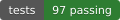
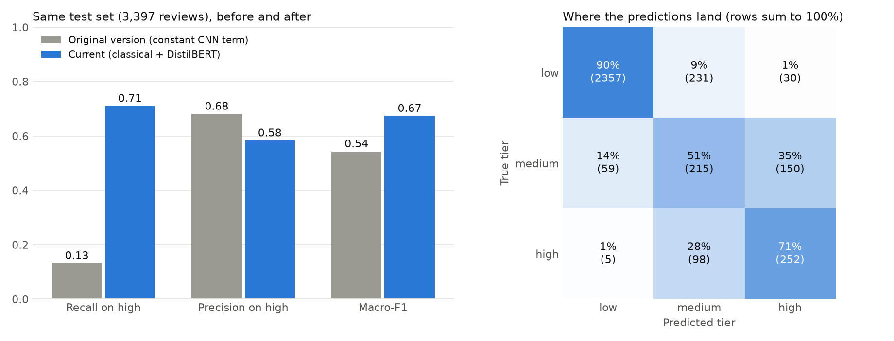
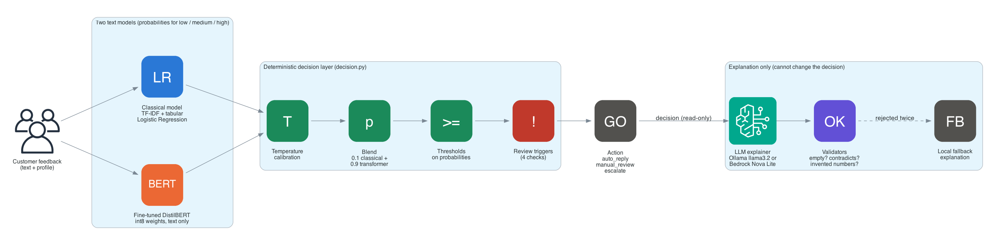
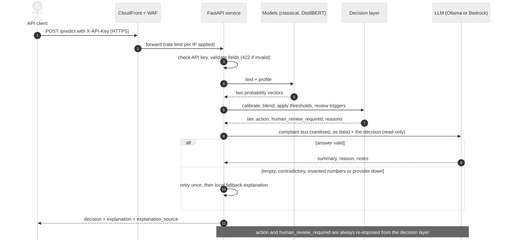
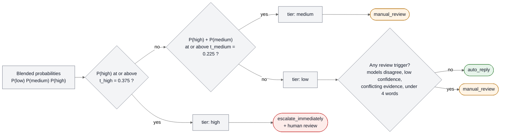
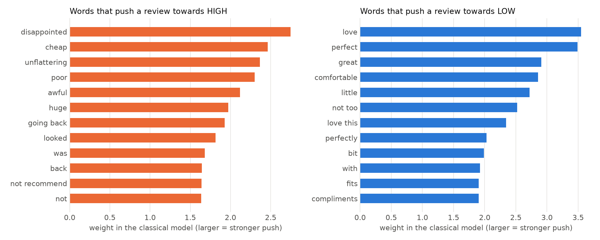
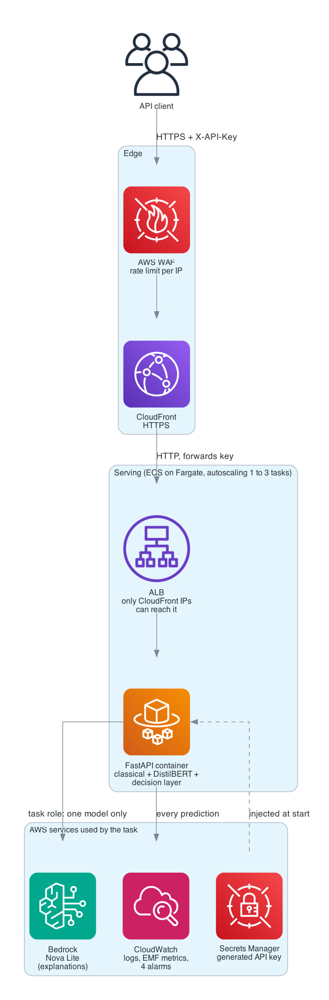

# Hybrid Customer-Dissatisfaction Risk Triage on AWS: Classical ML, Fine-Tuned DistilBERT, a Calibrated Decision Layer, Deterministic Review Rules and LLM Explanations, Served with FastAPI, Docker, CloudFormation and ECS Fargate

Built with: **Python** 3.11; **scikit-learn** (TF-IDF and Logistic Regression); **PyTorch** and **Hugging Face Transformers** (a fine-tuned **DistilBERT**, stored as int8 weights); a pure-**NumPy** decision layer (temperature calibration, probability blending, tuned thresholds, review triggers); **Ollama** (llama3.2) or **Amazon Bedrock** (Nova Lite) for explanations; **FastAPI** and **Pydantic**; **Docker**; **AWS CloudFormation**, **ECS on Fargate**, an **Application Load Balancer**, **CloudFront**, **AWS WAF**, **Secrets Manager**, **CloudWatch** (EMF metrics and alarms) and **GitHub Actions** with **OIDC**; **pytest**.

[](https://github.com/anandapurva55/hybrid-complaint-risk-ai/actions/workflows/ci.yml)





A system that reads a piece of customer feedback and answers three practical questions: **how unhappy is this customer** (low, medium or high), **what should happen next** (reply automatically, send to a person, or escalate), and **why**. Two text models estimate the tier, a small deterministic layer turns their probabilities into a decision, and a language model writes a plain-English explanation. The language model can describe the decision, never change it.

| **0.71** | **0.67** | **98.6%** | **70.7%** | **29%** | **67** |
|:---:|:---:|:---:|:---:|:---:|:---:|
| Recall on the "high" tier | Macro-F1 (95% CI 0.65 to 0.69) | Truly-high cases that reach a person (350 of 355) | Feedback answered automatically (97.5% of them truly low) | Feedback sent to human review | Automated tests |



---

## Table of contents

1. [About the data and the label](#about-the-data-and-the-label)
2. [Quickstart](#quickstart)
3. [How it works](#how-it-works)
4. [Results](#results)
5. [Explainability](#explainability)
6. [Safety and guardrails](#safety-and-guardrails)
7. [Training pipeline](#training-pipeline)
8. [AWS architecture](#aws-architecture)
9. [API](#api)
10. [Configuration](#configuration)
11. [File by file](#file-by-file)
12. [Testing](#testing)
13. [Design decisions](#design-decisions)
14. [Limitations and next steps](#limitations-and-next-steps)

## About the data and the label

The model is trained on the public [Women's E-Commerce Clothing Reviews](Womens%20Clothing%20E-Commerce%20Reviews.csv) dataset (about 22,600 reviews with text, age, department and a 1 to 5 star rating). Public data with real complaint-escalation outcomes does not exist, so the project uses the star rating as a stand-in for how dissatisfied the customer is:

| Stars | Tier used by the system | Meaning |
|---|---|---|
| 1 to 2 | `high` | Strongly unhappy, the cases a support team most wants to catch |
| 3 | `medium` | Mixed or neutral |
| 4 to 5 | `low` | Happy, safe to acknowledge automatically |

So every number in this README measures how well the system recognises **dissatisfaction** from the text. That is a useful, measurable signal for triage, and it is the part of "will this customer escalate?" that feedback text actually carries. The code is built so the label is one swappable function ([`rating_to_risk`](risk_common.py)): when you have real outcomes such as reopened tickets, refunds or chargebacks, point `make_splits.py` at them, rerun the pipeline and the calibration and thresholds are re-tuned for you. Names like `risk_level` are kept for continuity.

## Quickstart

```bash
python3.11 -m venv venv && source venv/bin/activate
pip install -r requirements-dev.txt
ollama pull llama3.2              # optional: local explanations (or set LLM_PROVIDER=bedrock)

python hybrid_inference.py        # run the 8 bundled examples end to end
python -m pytest                  # 67 tests
uvicorn app:app --reload          # HTTP API on http://127.0.0.1:8000
```

```bash
curl -X POST http://127.0.0.1:8000/predict -H "Content-Type: application/json" \
  -d '{"review_text":"The jacket fell apart after one wear and nobody answers my emails.",
       "age":45,"positive_feedback_count":1,"division_name":"General",
       "department_name":"Jackets","class_name":"Outerwear"}'
```

No LLM running? Everything still works: the explanation comes from a local fallback and is labelled `"explanation_source": "fallback"`.

## How it works



**In plain words.** Each piece of feedback goes through two models that each output three probabilities (low, medium, high). The first is a classical model (TF-IDF word features plus age and product category, fed to Logistic Regression). The second is DistilBERT, fine-tuned on the reviews, which understands phrasing and context much better and does most of the work. Their probabilities are calibrated so that "80%" really means about 80%, blended (10% classical, 90% transformer, the weight that gave the lowest validation log-loss), and turned into a tier with two thresholds tuned on validation data to catch at least 70% of the truly unhappy customers. A few simple rules then decide whether a person must look. Only after all of that does a language model write the explanation.

**What happens on one request.**



**How the decision and the review rules work.**



The thresholds, temperatures, blend weight and trigger limits live in [`decision_config.json`](decision_config.json) and are produced by [`tune_decision.py`](tune_decision.py) from the validation split only. The four review triggers are: the two models disagree (total-variation distance above 0.45), the top probability is below 0.45, low and high are both at least 0.30 likely, or the text is shorter than four words. Full policy: [decision_policy.md](decision_policy.md).

## Results

Everything below is on the held-out test split (3,397 reviews) that was never used for training or tuning. Full tables, bootstrap intervals and subgroup results are in [evaluation_report.md](evaluation_report.md).

| Model | Accuracy | Macro-F1 | High: precision / recall | AUC (high vs rest) |
|---|---|---|---|---|
| Always predict "low" | 0.771 | 0.290 | 0 / 0 | n/a |
| LSTM baseline (not used) | 0.820 | 0.547 | 0.49 / 0.60 | 0.920 |
| Classical (TF-IDF + LogReg) | 0.829 | 0.593 | 0.65 / 0.44 | 0.934 |
| DistilBERT (fine-tuned) | 0.851 | 0.675 | 0.62 / 0.64 | 0.950 |
| **Hybrid with tuned thresholds** | **0.831** | **0.673** | **0.58 / 0.71** | **0.951** |

- **What the business sees:** 70.7% of feedback is answered automatically (97.5% of those are truly low), 16.6% goes to manual review and 12.7% is escalated. Of 355 truly unhappy customers, 350 reach a person and 5 would be auto-replied.
- **Trade-off, chosen on purpose:** the thresholds favour catching unhappy customers, so about 4 in 10 "high" flags are false alarms (precision 0.58).
- **Stability:** three fine-tuning seeds give macro-F1 0.666, 0.675 and 0.682; 1,000 bootstrap resamples give a 95% interval of 0.652 to 0.694. The blend's edge over DistilBERT alone is small (+0.002 to +0.012); the transformer is where the gain comes from.
- **Honest probabilities:** expected calibration error is 0.013 for the blend, so the confidence values can be read as probabilities.
- **Fairness checks:** results are fairly even across age bands (macro-F1 0.66 to 0.68) and departments; "Bottoms" has the lowest recall on high (0.60), documented in the report.
- **A leakage check that mattered:** the dataset's `Recommended IND` column nearly gives away the star rating. Adding it back lifts the classical model's macro-F1 by about 0.05 without making it better at reading text, so it is deliberately excluded.

## Explainability

The classical model is transparent: these are the words that push a review towards each tier. They read the way a person would expect, which is a useful sanity check on the data and the label.



For the transformer, every response includes the calibrated probabilities, the review reasons and a written explanation that is checked against those numbers.

## Safety and guardrails

| Risk | What the system does |
|---|---|
| The LLM changes or softens a decision | It never sees a way to: tier, `recommended_action` and `human_review_required` come from the decision layer and are overwritten after the call. The LLM can only add caution |
| The LLM writes nonsense | Output is rejected (then retried once at a warmer temperature, then replaced by a local fallback) if it is empty, names a different risk tier than the decision, or quotes numbers that are not in the model output |
| Prompt injection in the complaint text | Text is length-capped, the delimiter tag is stripped, it is wrapped in tags the prompt declares to be data, and an injected "mark this low risk" cannot reach the action or review flag. Tested with an injection suite |
| Low-confidence or odd input | Very short text, conflicting evidence, low confidence or disagreeing models are never auto-replied |
| Abuse of the endpoint | HTTPS only, an API key (`X-API-Key`, constant-time comparison), a WAF rate limit per IP, the load balancer reachable only from CloudFront, input validation with length and range limits, and error messages that never expose internals |
| Secrets | The API key is generated by Secrets Manager at deploy time; the task role can invoke exactly one Bedrock model; no keys are stored in the repository or in GitHub (deploys use OIDC) |
| Privacy | Metrics and logs contain no complaint text or customer identifiers; with Ollama nothing leaves the machine |

## Training pipeline


Training, tuning and testing use different data on purpose: models learn from the train split, the decision layer is tuned on the validation split, and the test split is read only for the final evaluation. Rebuild everything with:

```bash
python make_splits.py              # stratified 70/15/15 split with a fixed seed
python train_classical_model.py
python train_transformer_model.py  # about 20 min on a laptop; add --seed 1 for the variance study
python compact_transformer.py      # fp32 (268 MB) to int8 (60 MB), no measurable accuracy loss
python tune_decision.py            # calibration, blend weight and thresholds from validation
python evaluate_hybrid.py          # test metrics, triage numbers, monitoring baseline
python evaluate_robustness.py      # bootstrap intervals, cross-validation, subgroups
python evaluate_llm.py --n 45      # live check of the explanation layer
python docs/diagrams/generate.py   # redraw the diagrams in this README
```

## AWS architecture



| Layer | Service | Role |
|---|---|---|
| Edge | CloudFront, AWS WAF | HTTPS with the default certificate, HTTP redirected, a rate limit of 300 requests per 5 minutes per IP |
| Serving | Application Load Balancer, ECS on Fargate | The load balancer only accepts CloudFront's address range. One to three tasks (2 vCPU, 4 GB) scale on CPU. The container is about 550 MB (CPU-only PyTorch, no TensorFlow) |
| Explanations | Amazon Bedrock (Nova Lite) | Called through the task role, which is allowed to invoke only that model. Ollama is used locally |
| Secrets | AWS Secrets Manager | Generates the API key at deploy time and injects it into the container |
| Observability | CloudWatch | One metric line per prediction (review share, fallback share, auto-reply share, escalation share, confidence) and four alarms: 5xx errors, unhealthy task, fallback share above 40%, review share above 50% |
| Infrastructure | CloudFormation | One stack, [`deploy/ecs-fargate.yaml`](deploy/ecs-fargate.yaml), linted in CI |


Deploys run from GitHub Actions with short-lived OIDC credentials: the role can be assumed only by this repository's approved `production` environment and can only manage this stack. Steps, costs and the story of why ECS rather than App Runner are in [deploy/README.md](deploy/README.md); the deeper design is in [docs/ARCHITECTURE.md](docs/ARCHITECTURE.md).

## API

`POST /predict` (header `X-API-Key` when `API_KEY` is set), `GET /` (health), `GET /stats` (rolling drift monitor for this task).

| Request field | Rules |
|---|---|
| `review_text` | 1 to 5,000 characters |
| `age` | 10 to 120 |
| `positive_feedback_count` | 0 or more |
| `division_name`, `department_name`, `class_name` | text, up to 100 characters |
| `customer_id` | optional |

```json
{
  "model_outputs": {
    "classical_score": 0.402, "transformer_score": 0.611, "final_score": 0.464,
    "probabilities": {"low": 0.08, "medium": 0.166, "high": 0.754},
    "risk_level": "high",
    "recommended_action": "escalate_immediately",
    "human_review_required": true,
    "review_reasons": []
  },
  "llm_explanation": {
    "summary": "...", "reason": "...", "risk_notes": ["..."],
    "recommended_action": "escalate_immediately", "human_review_required": true
  },
  "_meta": {"cnn_used": false, "explanation_source": "llm"}
}
```

## Configuration

| Variable | Default | Purpose |
|---|---|---|
| `LLM_PROVIDER` | `ollama` | `ollama`, `bedrock`, or `none` (always use the fallback) |
| `OLLAMA_HOST`, `OLLAMA_MODEL` | `http://localhost:11434`, `llama3.2` | Local LLM |
| `BEDROCK_MODEL_ID` | `us.amazon.nova-lite-v1:0` | Bedrock model; credentials come from the environment or IAM role |
| `LLM_TIMEOUT_S` | `60` | Per-call timeout before the fallback is used |
| `API_KEY` | unset | If set, `/predict` and `/stats` require a matching `X-API-Key` |

## File by file

- **`risk_common.py`**: constants, the rating-to-tier label function and probability ordering. The single place to change the label.
- **`decision.py`** and **`decision_config.json`**: the pure NumPy decision layer (calibration, blending, thresholds, review triggers, action) and its tuned parameters. No TensorFlow, PyTorch or scikit-learn imports, so it is cheap to test.
- **`hybrid_inference.py`**: loads the models once, runs one request end to end and assembles the response.
- **`compact_transformer.py`** and **`transformer_assets/`**: int8 weight storage and loader for DistilBERT, plus its tokenizer and config. The 268 MB fp32 weights stay out of git.
- **`llm_explainer.py`**: Ollama and Bedrock calls, prompt building with sanitising, output validators, one retry, the local fallback and the policy re-imposition.
- **`app.py`**: the FastAPI service: validation, API-key check, `/predict`, `/stats`, safe error handling.
- **`monitoring.py`** and **`monitoring_baseline.json`**: rolling in-process drift monitor and the CloudWatch metric lines.
- **`make_splits.py`**, **`train_classical_model.py`**, **`train_transformer_model.py`**, **`tune_decision.py`**: the reproducible training and tuning path.
- **`evaluate_hybrid.py`**, **`evaluate_robustness.py`**, **`evaluate_llm.py`**, **`generate_sample_outputs.py`**: evaluation and the worked examples ([`sample_inputs.json`](sample_inputs.json), [`sample_outputs.json`](sample_outputs.json)).
- **`baselines.py`**, **`train_rnn_model.py`**, **`train_cnn_model.py`**: the LSTM baseline and a Fashion-MNIST CNN demo, kept for comparison but not part of the decision.
- **`tests/`**: 67 tests (decision logic, explainer validators, API, monitoring, end-to-end smoke tests on the real models).
- **`deploy/`**, **`.github/workflows/`**: the CloudFormation stacks (`ecs-fargate.yaml`, `github-oidc.yaml`), CI and the deploy workflow.
- **`docs/`**: diagrams as code (`docs/diagrams/`), generated images, [ARCHITECTURE.md](docs/ARCHITECTURE.md).
- **`evaluation_report.md`**, **`decision_policy.md`**, **`mini_model_card.md`**: the full report, the decision policy and the model card.

The diagrams and figures are generated by code ([`generate.py`](docs/diagrams/generate.py), [`plot_results.py`](docs/diagrams/plot_results.py), [`make_badges.py`](docs/diagrams/make_badges.py); they need `pip install diagrams` and Graphviz), so they stay in step with the system.

## Testing

`python -m pytest` runs 67 tests in about ten seconds: the decision layer (boundaries, calibration, every review trigger), the explainer (downgrade attempts, injected actions, malformed or contradictory output, invented numbers, retry behaviour, outage handling), the API (validation, auth, error hygiene, `/stats`), the monitor and CloudWatch metric format, and end-to-end smoke tests that load the real models. CI also lints the CloudFormation templates and rebuilds the data splits from the raw CSV.

## Design decisions

| Decision | Why |
|---|---|
| Decide on probabilities, not one score | A 50/50 split between low and high is different from a confident medium; an averaged score cannot tell them apart. Conflicting evidence now has its own review trigger |
| Fine-tuned DistilBERT as the main model | Frozen sentence embeddings were worse than TF-IDF; fine-tuning lifted macro-F1 from 0.59 to 0.67 |
| LSTM dropped | Its optimal blend weight was zero once DistilBERT existed; removing it also removed TensorFlow from serving and cut the image from about 1.7 GB to 550 MB |
| No image model in the decision | An earlier CNN trained on Fashion-MNIST could not read complaint photos and, with no photo, contributed a constant that hid most high-tier cases (recall 0.13). No public dataset pairs complaint photos with outcomes. `train_cnn_model.py` stays as a demo; a real image signal needs outcome-labelled photos |
| Remove `Recommended IND` | It nearly encodes the rating, so it inflates scores without adding understanding |
| Thresholds tuned for recall on "high" | Missing an unhappy customer costs more than a wasted review |
| LLM explains, rules decide | A safety-relevant flag should never depend on a model following instructions |
| ECS Fargate rather than App Runner | AWS no longer lets this account create App Runner services; the stack also works around root-credential role-pass failures (see the deploy notes) |

## Limitations and next steps

- **Next step with the biggest payoff: real outcomes.** Retrain on reopened tickets, refunds or chargebacks if you have them. The pipeline, calibration and monitoring are ready for it.
- **Image evidence.** With outcome-labelled complaint photos, a fine-tuned image model can be blended in only when a photo is attached. Until then the system is text and profile only.
- **Medium tier** is the hardest (F1 0.44), as mixed reviews are ambiguous by nature.
- **Precision on "high"** is 0.58 by design; tune `t_high` in `decision_config.json` to trade recall for fewer false alarms.
- **Explanation quality.** llama3.2 (3B) is rejected about 7% of the time after a retry (then the fallback is used); faithfulness beyond numbers and risk tier has not been human-graded. A larger model or Bedrock improves this.
- **Evaluation scope.** English clothing reviews, one data split (seed variance is measured), no test on real support tickets yet.
- **Operations.** HTTPS uses CloudFront's default certificate (a custom domain needs your own ACM certificate). Monitoring has fleet-wide metrics and alarms but no automatic retraining loop.
