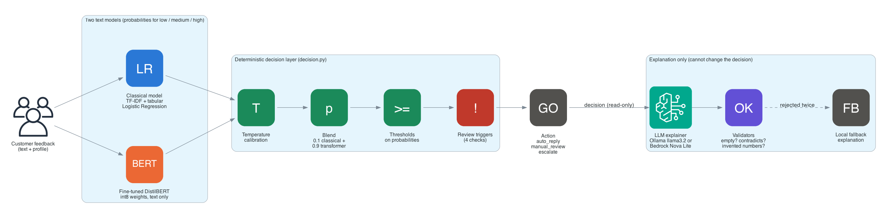
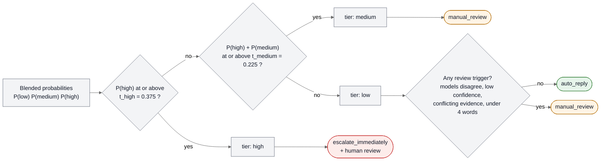

# Decision Policy

[Back to the main README](README.md)

How model output becomes a business action, when a human must review, and what the **LLM** may and may not do. The code is the source of truth ([`decision.py`](decision.py), [`decision_config.json`](decision_config.json), [`llm_explainer.py`](llm_explainer.py)); this document explains it.

**Scope note.** `risk_level` is a *dissatisfaction tier derived from star ratings*, used as a proxy for escalation risk. It has not been validated against real escalation outcomes.

## 1. Producing the risk level

1. Each text model (classical; **fine-tuned** **DistilBERT**) outputs class probabilities `[P(low), P(medium), P(high)]`.
2. Each is temperature-calibrated (one scalar per model, fit on validation).
3. They are blended: `p = w * p_classical + (1 - w) * p_transformer` (`w` = 0.1, chosen to minimise validation **log-loss**; the old **LSTM** got weight 0 and was dropped).
4. Decision on the **probabilities** (not a collapsed scalar):
   - `high` if `P(high) >= t_high`
   - else `medium` if `P(high) + P(medium) >= t_medium`
   - else `low`

   `t_high` and `t_medium` are selected on validation: among **thresholds** with validation **recall** on `high` >= 0.70, the pair with the best **macro-F1**. Current values are in `decision_config.json`.

Why probabilities rather than an expected-value score: `0*P(low) + 0.5*P(medium) + 1*P(high)` gives a 50/50 low-vs-high split the same value as a confident medium. Medium here means a mixed/neutral review, not a midpoint, so contradictory evidence must be detectable (see triggers). The scalar `final_score` is still returned for display only.

The **CNN** is **not** part of the decision (README, "Why the **CNN** is not in the decision").

## 2. Default action

| Risk level | Action |
|---|---|
| high | `escalate_immediately` (and human review) |
| medium | `manual_review` |
| low | `auto_reply`, **unless** a review trigger fired, then `manual_review` |

`recommended_action` is computed deterministically (`decision.action_for`); the **LLM** cannot change it.

## 3. Human-review triggers

Review is required when any of these holds:

| Trigger | Rule (parameters in `decision_config.json`) |
|---|---|
| high risk | `risk_level == "high"` |
| medium risk | `risk_level == "medium"` |
| `conflicted` | `min(P(low), P(high)) >= conflict_min`: the evidence points both ways |
| `low_confidence` | top class probability `< max_proba_floor` |
| `models_disagree` | classical vs **transformer**: total-variation distance between their probabilities `> disagreement_tv` |
| `short_text` | fewer than 4 words: too little for the text models |

All are implemented in code and unit tested. On the test split these send 29.3% of cases to humans (see `evaluation_report.md`). The previous max-minus-min score-spread rule is gone: it compared against a constant **CNN** value and fired on ~81% of cases.

## 4. Cost asymmetry

A false negative (a genuinely dissatisfied customer auto-replied) is costlier than a false positive (wasted reviewer time). Hence **thresholds** are tuned for high-class **recall** (target 0.70 on validation; achieved 0.71 on test, at **precision** 0.58), and any low case showing conflict or low confidence is withheld from auto-reply. Only 1.4% of truly-high test cases (5 of 355) would have been auto-replied.

## 5. What the LLM may do

Allowed: summarise, explain in business language, add notes, and be *more* cautious (it can set `human_review_required = true` where policy does not require it).

Not allowed, and enforced in code after the call:
- changing scores, `risk_level`, or `recommended_action` (overwritten from the deterministic assessment);
- lowering `human_review_required` (it is OR-ed with the policy value);
- crashing the pipeline: provider errors, timeouts (60 s) and malformed or mistyped JSON fall back to a local explanation that is still policy-correct. Provider is `LLM_PROVIDER` = `bedrock` (default) or `none`;
- being accepted when it is useless or wrong: explanations that are empty, state a risk level different from the decision, or quote numbers not in `model_outputs` are rejected and replaced by the fallback.

Complaint text is untrusted: it is length-capped, our delimiter tag is stripped, it is wrapped in `<complaint>` tags the prompt declares to be data, and free-text outputs are length-capped. Injection cannot change the action or review flag because those never come from the **LLM**.

## 6. Secrets and data

Explanations use **Amazon Bedrock** through an IAM role (no key in code); complaint text is sent to **Bedrock** for the explanation. Set `LLM_PROVIDER=none` to keep everything in-process. If `API_KEY` is set, `/predict` requires a matching `X-API-Key` header.
