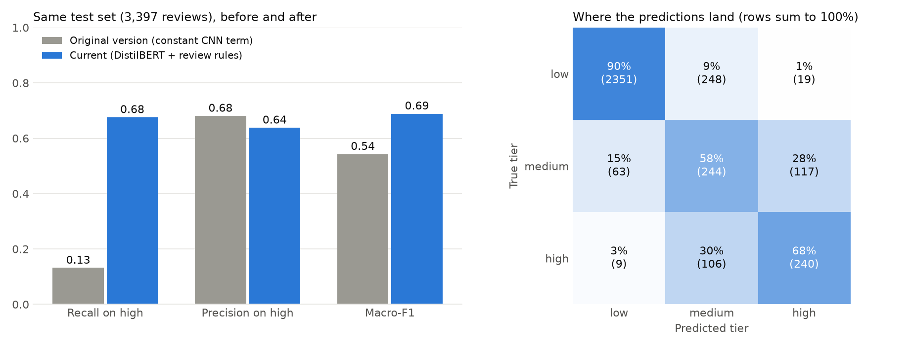
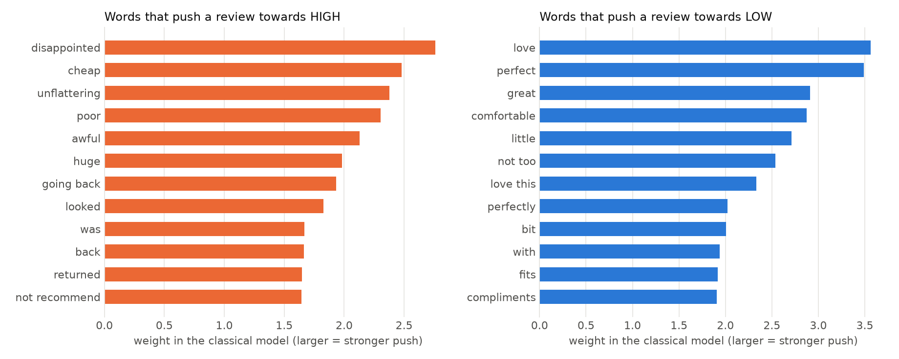

# Evaluation Report

[Back to the main README](README.md)

All numbers are on the held-out **test split** (3,397 rows, stratified 70/15/15, `RANDOM_STATE = 42`, regenerated by [`make_splits.py`](make_splits.py)). Raw results: [`evaluation_results.json`](evaluation_results.json) ([`evaluate_hybrid.py`](evaluate_hybrid.py)) and [`robustness_results.json`](robustness_results.json) ([`evaluate_robustness.py`](evaluate_robustness.py)). Calibration temperatures, blend weight and **thresholds** were tuned on the **validation** split only ([`tune_decision.py`](tune_decision.py)).

**What is being measured.** The label is a proxy: 1-2 stars = `high`, 3 = `medium`, 4-5 = `low`. These are *dissatisfaction tiers inferred from review ratings*, not observed complaint escalations; no data here says whether anything escalated. Read every metric as "how well do we recover the dissatisfaction tier from text and profile", a stand-in for escalation risk, not a measurement of it. Class shares: low 77.1%, medium 12.5%, high 10.5%.

## 1. Models

| Component | Role |
|---|---|
| Classical | **TF-IDF** + age, feedback count, division/department/class -> LogReg (no `Recommended IND`, no class weights) |
| Transformer | **DistilBERT** **fine-tuned** on review text (2 epochs, train split), int8-compressed weights |
| **LSTM** | Baseline only. Its optimal blend weight was 0 once the **transformer** existed, so it was dropped from the decision (and TensorFlow from serving) |
| **CNN** | Not used (**Fashion-MNIST**; cannot judge complaint photos) |

Frozen sentence embeddings (MiniLM) + LogReg were also tried and were worse than the **classical model** (**AUC** 0.889 vs 0.934), so they were dropped; **fine-tuning** is what helped.

## 2. Results

### Components at plain argmax (no tuning)

| Model | Accuracy | **Macro-F1** | High **precision** | High **recall** | **AUC** (high vs rest) |
|---|---|---|---|---|---|
| Always "low" | 0.771 | 0.290 | 0 | 0 | n/a |
| **LSTM** (baseline) | 0.820 | 0.547 | 0.493 | 0.597 | 0.920 |
| Classical | 0.829 | 0.593 | 0.649 | 0.437 | 0.934 |
| **Transformer** | **0.851** | **0.675** | 0.620 | 0.639 | **0.950** |

### Hybrid (0.1 classical + 0.9 transformer, calibrated, thresholds tuned on validation)

| System | Accuracy | **Macro-F1** | High **precision** | High **recall** | **AUC** |
|---|---|---|---|---|---|
| Transformer alone (same **thresholds**) | 0.829 | 0.667 | 0.570 | 0.710 | 0.950 |
| **Hybrid** | **0.831** | **0.673** | **0.583** | **0.710** | **0.951** |

Per-class (hybrid): low P 0.974 / R 0.900; medium P 0.395 / R 0.507 (F1 0.444); high P 0.583 / R 0.710 (F1 0.640).

| True \ predicted | low | medium | high |
|---|---|---|---|
| **low** | 2357 | 231 | 30 |
| **medium** | 59 | 215 | 150 |
| **high** | 5 | 98 | 252 |

**Uncertainty (1,000 bootstrap resamples of the test set, 95% CI):** hybrid **macro-F1** 0.652-0.694; high **recall** 0.660-0.755; high **precision** 0.540-0.629. Hybrid minus transformer-alone **macro-F1**: +0.002 to +0.012. The blend helps, but only slightly (the CI excludes zero by a hair; the comparison is mildly favourable to the hybrid because the **thresholds** were tuned for it). The **transformer** is where the gain comes from. Classical model 5-fold CV on train+val: **macro-F1** 0.586 +/- 0.011, accuracy 0.827 +/- 0.005, so test results are not a lucky split for that model.

### Training-seed variance (transformer)
Three **fine-tuning** runs with different seeds ([`seed_runs/`](seed_runs/)): test **macro-F1** at argmax 0.675 (shipped, seed 42), 0.666 (seed 1), 0.682 (seed 2); mean 0.674, spread about +/-0.008. High-vs-rest **AUC** 0.950 / 0.951 / 0.953. The **transformer**'s advantage over the **classical model** (0.593) is many times larger than seed noise; the tiny hybrid-over-transformer gain (+0.002 to +0.012) is of the same order as seed noise, so treat it as unproven.

### History of the redesign (same test split)

| | v1 (**CNN** fixed at 0.4, 0.45/0.75 **thresholds**) | v2 (probabilities, classical + **LSTM**) | v3 (current: classical + **DistilBERT**) |
|---|---|---|---|
| Recall on high | 0.132 | 0.730 | 0.710 |
| Precision on high | 0.681 | 0.498 | 0.583 |
| **Macro-F1** | 0.543 | 0.622 | 0.673 |
| Medium F1 | n/a | 0.353 | 0.444 |
| Truly-high cases auto-replied | 29 | 16 | 5 |
| Cases forced to human review | 80.7% | 29.7% | 29.3% |

v1 was measured by running the original models on this split. The constant **CNN** term made "high" nearly unreachable and made the disagreement rule fire on ~81% of cases.

### Leakage ablation: `Recommended IND`
Adding it back to the **classical model** raises argmax **macro-F1** 0.593 -> 0.639 (accuracy 0.829 -> 0.863). That ~0.05 is leakage (it is a near-proxy of the rating the label comes from), which is why the feature was removed and why the first version's headline numbers (0.845 / 0.666) were inflated.

### Calibration (ECE of top-class confidence)

| | raw | after temperature scaling (fit on validation) |
|---|---|---|
| Classical | 0.035 | 0.029 |
| Transformer | 0.025 | 0.012 |
| Hybrid | n/a | 0.013 |

### Ordinal modelling (negative result)
Two cumulative binary models (`>=medium`, `=high`) instead of the multinomial **classical model**: best-grid **macro-F1** 0.643 vs 0.650 and high **AUC** 0.929 vs 0.934. No gain, so the multinomial form was kept.

### What the classical model reads

The words that push a review towards each tier, from the **classical model**'s weights. They read the way a person would expect, a useful sanity check on the data and the label.

## 3. Triage behaviour (test set)

| Action | Share |
|---|---|
| `auto_reply` | 70.7% |
| `manual_review` | 16.6% |
| `escalate_immediately` | 12.7% |

- Human review (high, medium, or any trigger): 29.3%. Triggers: models disagree 5.7%, low confidence 3.5%, very short text 0.2%, conflicted evidence 0.03%.
- Of 355 truly-high cases, **350 (98.6%) reach a human**; 5 (1.4%) would be auto-replied.
- Auto-replied cases are 97.5% truly low; 89.5% of all truly-low cases are auto-replied.

## 4. Subgroups (hybrid, test set)

| Group | n | **Macro-F1** | High **recall** (n true high) | Truly-high auto-replied |
|---|---|---|---|---|
| Age <30 | 441 | 0.664 | 0.75 (52) | 0% |
| 30-45 | 1624 | 0.676 | 0.70 (161) | 1.9% |
| 46-60 | 980 | 0.677 | 0.71 (111) | 0.9% |
| 60+ | 352 | 0.659 | 0.71 (31) | 3.2% |
| Dept: Tops | 1486 | 0.686 | 0.73 (161) | 1.2% |
| Dresses | 973 | 0.668 | 0.72 (108) | 0.9% |
| Bottoms | 543 | 0.633 | **0.60 (48)** | 2.1% |
| Jackets | 133 | 0.674 | 0.76 (21) | 0% |
| Intimate | 247 | 0.695 | 0.65 (17) | 5.9% (1 case) |

Performance is fairly even across age bands. Bottoms has the lowest high **recall** (0.60) and the lowest **macro-F1**; the Intimate and Jackets numbers rest on 17-21 high cases and are noisy. No formal fairness test was run, and only age is demographic-adjacent in the features.

## 5. The CNN
Not part of the decision and not evaluated here (**Fashion-MNIST**, 10 clothing categories, accuracy 0.83 on that task). No public dataset pairs complaint photos with outcome labels (a search found only factory fabric-defect sets and image+complaint-text sets without outcomes), so no honest image signal could be built.

## 6. The LLM layer
**Amazon Bedrock**, **Nova Lite** (`us.amazon.nova-lite-v1:0`). It only explains; risk level, `recommended_action` and `human_review_required` come from the deterministic layer and are re-imposed after the call. Evaluated live ([`evaluate_llm.py`](evaluate_llm.py)) on 45 stratified test rows plus 3 injection strings:

| Check | Result |
|---|---|
| Schema valid / action equals policy / review never downgraded | 100% |
| Non-empty and consistent with the decided risk level | 100% |
| Quoted numbers match `model_outputs` | 100% |
| Injection suite: action unchanged | 3 / 3 |
| Responses that came from the **LLM** (rest rejected twice -> fallback) | 100% (45 of 45) |

The pass rates are measured *after* the validators in `llm_explainer.py` (empty, contradictory or numerically invented output is rejected and retried once, then replaced by a local fallback), so they hold by construction; the quality signal is how often the validators had to step in, which was never on this run (0 of 45 fallbacks here, though one of the 8 bundled examples did fall back in another run, so the rate is low but not zero). Early development with a small 3B-parameter model showed why the validators exist: it wrote `reason: "Low risk"` for a high-risk case, returned empty fields and invented figures such as "863% probability", and about 7% of its answers were still rejected after the retry. **Nova Lite** did not show these failures here, but n = 45 is small and faithfulness beyond numbers and risk tier (for example an invented product defect) is not checked automatically or human-graded.

## 7. Remaining limitations
1. **Proxy label.** Largest limitation; only real escalation outcomes fix it. Reviews are also not support tickets.
2. **High precision is 0.58:** ~4 in 10 "high" flags are false alarms, by design (recall-first).
3. **Medium** is the weak class (F1 0.44), inherently ambiguous.
4. **Single dataset, English, clothing.** No test on real support tickets.
5. **Tuning and test share one random split.** Seed variance is now measured for the **transformer** (above) but not for the **classical model**'s split.
6. **Monitoring:** `/stats` is per container, but every prediction also emits **CloudWatch** **EMF** metrics (review share, fallback share, auto-reply share, escalation share, mean confidence) with alarms, so fleet-wide drift signals exist when deployed on AWS. No automatic retraining or label feedback loop.
7. **int8 weights:** measured accuracy cost is nil (**macro-F1** 0.6751 vs 0.6749 argmax), but only on this test set.
